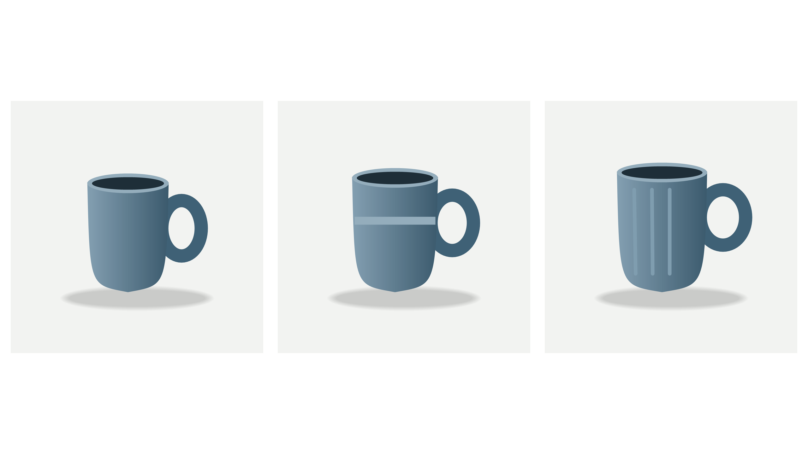
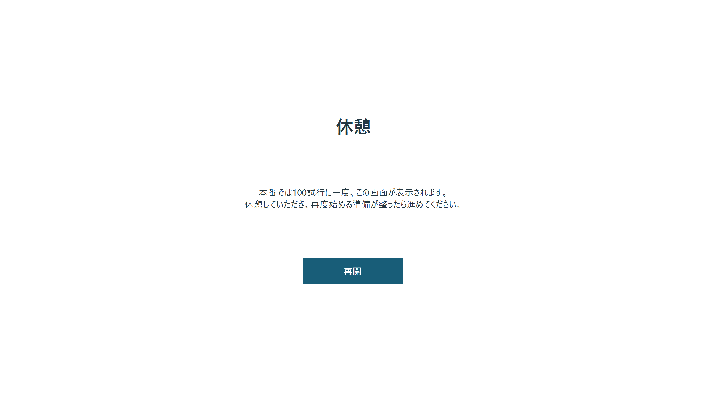
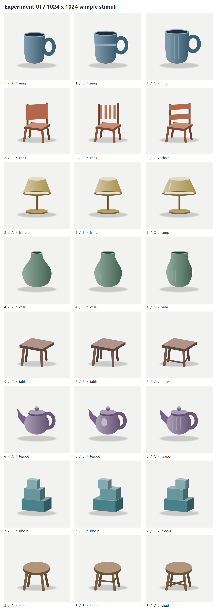

# 心理実験用GUI — 3枚の画像から選択

PowerPoint「CVPR2027 UI案.pptx」を参考にした、Windows用の画像選択GUIです。白背景に3枚の正方画像を横並びで提示し、画像の選択と反応時間を記録します。

## 実験画面

付属のテスト画像を提示した実際の実験画面です。3枚の画像から1枚をクリックして選択します。



## 本番用とテスト用

| 実行ファイル | 休憩の間隔 | 結果の初期保存先 |
|---|---|---|
| `ExperimentUI_Participant.exe` | 回答を100試行完了するごと | `.\results` |
| `ExperimentUI_Test.exe` | 全試行の中間で1回 | `.\results_test` |

テスト用は、全試行の中間で休憩画面を1回だけ確認するためのアプリです。付属の8試行では、4試行目の回答後に休憩し、再開後は5試行目から続けます。奇数の場合は全試行数の半分を切り捨てた位置で休憩します。1試行だけの場合は休憩を入れません。どちらも最後の試行が終わった後には休憩を入れません。

## 起動と実験の開始

PythonやWebブラウザーは使用しません。開始画面は**参加者ID入力と「開始」ボタン**だけです。**同梱の実行ファイルをそのまま起動でき、通常利用でビルドは不要です。** `build.cmd` はソースを変更したときや、実行ファイルを作り直す場合に使います。

1. 本番では `ExperimentUI_Participant.exe`、動作確認では `ExperimentUI_Test.exe` をダブルクリックします。
2. 複数のディスプレイがある場合は、**開始画面のウィンドウを実験に使うディスプレイへ移動**してください。ウィンドウのあるディスプレイが実験の全画面表示先になります。
3. 必要に応じて「**参加者ID**」を入力します。任意項目で、空欄なら結果フォルダに `anonymous` を使用します。
4. 「**開始**」を押します。画像を検証し、問題がなければ実験を開始します。実際の表示先の解像度などは自動保存します。
5. 提示された3枚のうち、選ぶ画像を左クリックします。全試行の終了後はEnter、Esc、または画面中央のクリックで開始画面に戻ります。

入力したIDは `responses.csv` の `participant`、`session.json` の `participant`、`display.json` の `participant_id` に保存します。セッションフォルダ名には、ファイル名に使える形へ整えたIDと固有IDを使います。空欄でも実行ごとに別フォルダを作り、既存の結果を変更しません。

## データフォルダと保存先の設定

使用する実行ファイルと同じ場所にある設定ファイルをテキストエディターで開き、`appSettings` 内のパスを編集します。変更後はGUIを終了し、再起動してください。

| 設定ファイル | 対象 |
|---|---|
| `ExperimentUI_Participant.exe.config` | 本番用 |
| `ExperimentUI_Test.exe.config` | テスト用 |

本番用の初期設定は次のとおりです。テスト用は `ResultsFolder` の初期値が `.\results_test` です。入力の初期値は、どちらも `.\experiment_data` です。それぞれの設定は独立しています。

```xml
<appSettings>
  <add key="DataFolder" value=".\experiment_data" />
  <add key="ResultsFolder" value=".\results" />
</appSettings>
```

| 設定 | 用途と初期値 |
|---|---|
| `DataFolder` | 入力画像のフォルダ。初期値は `.\experiment_data`。 |
| `ResultsFolder` | 実験結果と解像度記録の保存先。本番用の初期値は `.\results`、テスト用は `.\results_test`。 |

相対パスは **実行ファイルのあるフォルダ** が基準です。起動時のカレントフォルダには依存しません。`..\別のデータ`、`D:\Experiment\images` のような完全な絶対パス、`\\server\share\images` のようなUNCパスも使用できます。XMLのため、パスに `&` が含まれる場合は `&amp;` と記述します。たとえば `D:\A&B\images` は `value="D:\A&amp;B\images"` にします。

設定ファイルのほかの要素は保持し、パスの値を変更してください。再ビルドでも既存の設定ファイルは上書きしません。設定ファイルがない場合だけ、`source` 内の初期設定テンプレートから対応する設定を作成します。

配布フォルダの標準配置は次のとおりです。フォルダ一式を移動しても、同じ配置なら初期値のまま使えます。

```text
Experiment UI/
  ExperimentUI_Participant.exe
  ExperimentUI_Participant.exe.config
  ExperimentUI_Test.exe
  ExperimentUI_Test.exe.config
  README.md
  build.cmd
  test.cmd
  experiment_data/
    1_A_sample_mug_variant1.png
    1_B_sample_mug_variant2.png
    1_C_sample_mug_variant3.png
    ...
  results/                 実験時に作成
  results_test/            テスト用の結果
  source/                  再ビルド用ソース
  docs/                    実験画面・休憩画面・テスト画像一覧
  test_artifacts/          検証記録・表示例
```

初期データには動作確認用の**8試行・24枚**の画像が入っています。本実験では `experiment_data` の中を使用する画像一式に入れ替えるか、設定ファイルの `DataFolder` で別フォルダを指定してください。

## 実験データのファイル名

フォルダ直下のPNGを次の規則で読み込みます。サブフォルダは探索しません。

```text
{trial_number}_{A,B,C}_{Name}.png
```

| 要素 | 意味 |
|---|---|
| `trial_number` | 1以上の整数。小さい番号から順番に提示します。文字列順にはしません。 |
| `A` / `B` / `C` | 画面上の左／中央／右に対応します。 |
| `Name` | 実験者用の任意の名前。日本語やアンダースコアを使用できます。 |

たとえば `12_B_object_blue_version_2.png` は、試行番号12の中央画像として提示し、`Name` は `object_blue_version_2` として保存します。試行や画像位置のランダム化は行いません。番号に欠番があっても、存在する試行を数値順に提示します。`1` と `01` は同じ試行番号として扱います。

各試行にはA・B・Cが1枚ずつ必要です。重複、欠け、規則外のPNG名、壊れた画像、正方形でない画像がある場合は、開始せずエラーを表示します。PNG以外のファイルは無視します。画像の推奨寸法は**1024×1024 px**です。ほかの正方形サイズも読み込めますが、警告を記録します。拡張子・A/B/Cの大文字と小文字は区別しません。

画像ファイルのSHA-256を記録し、提示用読み込み時にも照合します。検証後に画像が変更された場合は実験を停止します。実験中は入力画像を変更しないでください。

## 提示と選択

- 最初の試行の前に中央の注視点「＋」を**1000 ms**提示します。
- 3枚の画像を同時に提示し、選択を待ちます。回答の制限時間はありません。
- 画像内で最初に受け取った左マウスボタン押下を採用します。画像外のクリック、右クリック、選択後の追加クリックは回答として扱いません。
- 選択画像の外側に青色の枠を**500 ms**表示します。
- 次の試行がある場合は、注視点「＋」を**1000 ms**提示してから次の3枚に進みます。最後の回答後も枠を表示し、その後終了画面に進みます。

画像準備に時間がかかる場合は準備画面を表示し、準備が完了してから1000 msの注視点を提示します。フィードバックや注視点の実際の表示時間は `phase_timing.csv` に記録します。

## 試行間の休憩

本番用は**回答済みの試行数が100の倍数**になったとき、テスト用は**全試行の中間で1回だけ**休憩画面を表示します。ファイル名の試行番号ではなく、そのセッションで回答を完了した件数で数えます。中断して回答しなかった提示は件数に含めません。

選択枠の500 ms表示が終わってから休憩画面に進みます。休憩時間の上限や自動再開はなく、参加者が**再開ボタン**をクリックすると次の試行に進みます。再開後にも注視点「＋」を1000 ms提示します。最終試行後は休憩を入れず終了します。

テスト用の休憩画面には、次の文を表示します。

> 本番では100試行に一度この画面が表示されます。休憩していただき、再度始める準備が整ったら進めてください。



## 一時停止と途中終了

Escを押すと実験の終了確認を表示します。「いいえ」なら再開します。別のアプリを操作するなどして実験画面からフォーカスが外れた場合も一時停止します。Enter、または画面中央のクリックで再開できます。

回答前の提示が中断された場合、その行を `status=interrupted` として保存し、再開後は注視点から同じ試行をやり直します。`attempt` が増え、中断行の反応時間と選択は空欄です。回答後の枠表示中に中断された場合は、保存済みの回答を保ち、再開後に枠を500 ms表示して次へ進みます。終了確認で「はい」を選んだ場合も、それまでの記録を残します。

実験中に解像度や表示先が変わった場合は停止します。表示環境を設定してから、新たに開始してください。アプリを終了したセッションの途中再開機能はありません。

## 画面サイズと解像度の記録

実験は指定ディスプレイの現在の解像度で全画面表示します。画像は縦横比を保った正方形です。16:9の表示領域に対して、画像1枚の一辺を幅の31.25%に設定しています。

| ディスプレイ | 画像1枚の表示サイズ |
|---|---|
| 1920×1080 px | 600×600 px |
| 2560×1440 px | 800×800 px |

16:9以外のディスプレイでは、中央に収まる16:9領域を使用します。元画像の1024×1024 pxは入力画像の寸法であり、画面上の表示寸法とは別です。透明PNGは白背景に合成して提示します。

「開始」を押して実験を始めると、**実際に全画面表示するディスプレイの情報を自動記録**します。各セッションフォルダの `display.json` と `session.json` の `display` に、ディスプレイ名、幅と高さ、画面位置、現在の表示モード、リフレッシュレート、DPI、Windows拡大率などを保存します。`session.json` には画像の表示座標・寸法も記録します。画面上で解像度を保存する操作は不要です。

## 保存される結果

開始ごとに結果保存先の中へ、日時・参加者ID・固有IDを含む新しいセッションフォルダを作ります。以前の結果を使い回しません。

| ファイル | 内容 |
|---|---|
| `display.json` | 開始時の表示環境。`session_id`、`participant_id`、`ui_mode`、`experiment_mode`、`display`、`created_utc`。 |
| `responses.csv` | 試行番号、提示順、試行回数、状態、A/B/C各画像名とSHA-256、選択位置・画像名・Name、反応時間、UTC時刻、時計の生カウント、クリック座標。回答ごとに書き出します。 |
| `phase_timing.csv` | 各表示段階の開始・終了、要求時間と実時間、試行番号、中断などの理由。休憩の `Break` 行には実際の休憩時間を記録します。 |
| `events.jsonl` | 開始、回答、一時停止、再開、終了などのイベント。休憩は `break_started` / `break_resumed` で記録します。1行が1つのJSONです。 |
| `session.json` | 参加者ID、入力画像と名前の一覧、表示環境、配置、時計の情報、警告、終了状態、本番／テストの区別と休憩間隔。 |

通常の回答を集計するときは、`responses.csv` の **`status=selected`** を使用します。`trial_number` はファイル名の番号、`presentation_order` はそのセッションでの提示順、`attempt` は同じ試行の提示回数です。選択位置は `selected_position`、反応時間は **`rt_ms`（ミリ秒）** です。

`session.json` の `experiment_mode` は本番なら `production`、テスト用アプリなら `test` です。`breaks.schedule` は本番が `every_n_completed_trials`、テスト用が `once_at_midpoint` です。本番では `breaks.every_completed_trials` に100を、テスト用では `breaks.after_completed_trials` に中間の休憩位置を保存します。`breaks.self_paced` は任意時間の休憩であること、`breaks.resume_fixation_ms` は再開後の注視点時間です。テスト用アプリの実験データは通常起動でも `is_test=true` になり、本番の結果と区別できます。

日時の値はISO 8601形式のUTCです。ファイル／フォルダ名の日時は実行PCのローカル時刻を使用します。CSVはUTF-8で、Excelで開きやすいBOMを付けています。表計算ソフトで式と解釈される可能性のある文字列には先頭のアポストロフィを付けます。元の画像名・Name・参加者IDの正確な文字列はJSON側に保持します。

`session.json` の終了状態は、通常終了なら `completed`、途中終了なら `aborted`、検出したエラーによる停止なら `error` です。強制終了や電源断では `running` のまま残る場合があります。

## 反応時間の定義

3枚を描いた画面の処理が完了し、Windowsの描画同期 `DwmFlush` を呼び出した後のソフトウェア時刻を提示開始とします。左マウスボタン押下イベントの受信時刻との差を、高分解能の `Stopwatch` で計測して `rt_ms` に保存します。フィードバックの500 msと注視点の1000 msも、各画面の描画後の時刻を基準に進めます。

この時刻はソフトウェアによる提示時刻の推定です。フォトダイオードによる画面発光時刻の校正は行っていません。OSのスケジューリング、リフレッシュ周期、ディスプレイ内部処理、入力デバイスの遅延を含むため、物理的な提示・反応のミリ秒精度を保証するものではありません。本実験前に使用機器で動作と実際の表示時間を確認してください。

## テスト画像と再ビルド

付属画像は、マグ、椅子、ランプ、花瓶、テーブル、ティーポット、積み木、スツールの独自の図形画像です。すべて1024×1024 pxのRGB PNGで、各試行に3種類あります。GUIの動作確認用であり、心理実験刺激としての妥当性や難易度は検証していません。以下は付属する8試行・24枚のテスト画像一覧です。



ソースからのビルドは `build.cmd` を実行します。本番用の `ExperimentUI_Participant.exe` とテスト用の `ExperimentUI_Test.exe` を生成し、それぞれの既存の `.exe.config` は保持します。Windowsの.NET FrameworkのC#コンパイラーを使用し、外部パッケージのダウンロードやPowerShell実行ポリシーの変更は行いません。生成済みの実行ファイルを使う場合、再ビルドは不要です。動作環境はWindowsと.NET Framework 4.xの実行環境です。

`test.cmd` で画像読み込み・命名規則・CSV・結果保存・休憩位置のテストを実行できます。両アプリの `--smoke` 引数は、付属8試行の自動確認用です。全画面表示と自動応答を行い、検証結果は `test_artifacts` へ保存します。参加者が手動で試すときは、引数を付けずに `ExperimentUI_Test.exe` を起動してください。

## Gitアップロード用フォルダ

`Git_Upload` は、本番用・テスト用の実行ファイル2本と初期設定のConfig2本、ソース11ファイル、テスト画像24枚、画面例と画像一覧、`README.md`、`build.cmd`、`test.cmd`、`.gitignore` をまとめた配布用フォルダです。このフォルダをリポジトリのルートとして使用できます。フォルダ一式を配置すれば、ビルドせずに実行ファイルを起動できます。

`Git_Upload/.gitignore` は `results`、`results_test`、`test_artifacts` などを追跡対象から除外し、同梱した実行ファイル2本とConfig2本は追跡対象に含めます。配布するConfigは相対パスの初期値で、設定テンプレートも `source/default.config` と `source/default_test.config` に残しています。ソースを変更して配布版を更新する場合は `build.cmd` で実行ファイルを作り直します。
